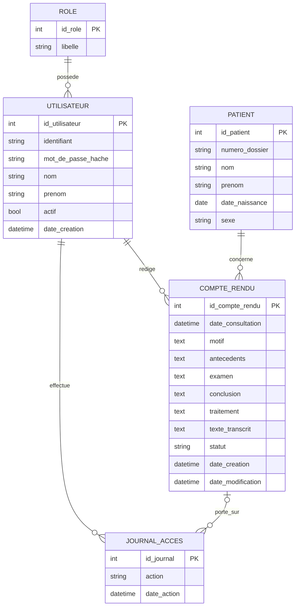

# 🩺 speech_to_text · Plateforme de comptes-rendus médicaux dictés


---

## 📑 Sommaire

1. [L'objectif du projet](#1--lobjectif-du-projet)
2. [Pourquoi tout se passe en local](#2--pourquoi-tout-se-passe-en-local)
3. [L'architecture cible](#3--larchitecture-cible)
4. [Les technologies et leur rôle](#4--les-technologies-et-leur-rôle)
5. [Où en est le projet](#5--où-en-est-le-projet)
6. [L'arborescence](#6--larborescence)
7. [Prérequis](#7--prérequis)
8. [Installation pas à pas](#8--installation-pas-à-pas)
9. [Toutes les commandes](#9--toutes-les-commandes)
10. [Comment fonctionne la transcription](#10--comment-fonctionne-la-transcription)
11. [Docker expliqué](#11--docker-expliqué)
12. [La CI expliquée](#12--la-ci-expliquée)
13. [La méthode de travail et les tests](#13--la-méthode-de-travail-et-les-tests)
14. [Le modèle de données · MCD et MLD](#14--le-modèle-de-données--mcd-et-mld)
15. [Utilisateurs, rôles et sécurité des données de santé](#15--utilisateurs-rôles-et-sécurité-des-données-de-santé)
16. [La feuille de route complète](#16--la-feuille-de-route-complète)
17. [Journal des erreurs rencontrées et leurs solutions](#17--journal-des-erreurs-rencontrées-et-leurs-solutions)
18. [Décisions en attente](#18--décisions-en-attente)
19. [Conventions du projet](#19--conventions-du-projet)
20. [Glossaire](#20--glossaire)

---

## 1. 🎯 L'objectif du projet

### Le besoin

Un médecin passe beaucoup de temps à **taper** ses comptes-rendus de consultation. L'idée est de lui permettre de **parler** à la place

### Ce que fera la plateforme

1. Le médecin **se connecte** avec son identifiant et son mot de passe
2. Il choisit ou crée la **fiche du patient** (nom, prénom, date de naissance, sexe, numéro de dossier)
3. Il clique sur 🎙️ et **dicte** son compte-rendu
4. L'audio est **transformé en texte** automatiquement, sur le serveur de l'établissement, par une intelligence artificielle (Whisper)
5. Le médecin **relit et corrige** le texte, réparti dans des champs structurés (motif, antécédents, examen, conclusion, traitement)
6. Il **valide** le compte-rendu, qui est **enregistré dans une base MySQL**
7. Chaque lecture ou modification est **tracée** dans un journal (qui, quoi, quand)
8. Selon son **rôle**, chaque utilisateur ne voit que ce qu'il a le droit de voir (médecin, secrétaire, administrateur)

### L'objectif pédagogique

Ce projet sert aussi à **apprendre** le métier de développeuse, en particulier

- organiser un projet Python propre (package, environnement, dépendances épinglées)
- écrire des **tests automatiques** (unitaires, intégration, bout en bout)
- conteneuriser avec **Docker** et **Docker Compose**
- automatiser les vérifications avec une **CI** GitHub Actions
- concevoir une base de données relationnelle (méthode **Merise** · MCD → MLD → SQL)
- construire une **API** avec FastAPI et la relier à un **front** HTML/CSS/JavaScript
- protéger des **données de santé** (RGPD, authentification, rôles, chiffrement, traçabilité)
- suivre la qualité d'un modèle de machine learning avec **MLflow** (MLOps)

---

## 2. 🔒 Pourquoi tout se passe en local

La voix d'un médecin qui parle de son patient est une **donnée de santé**. En France et en Europe, ces données sont très protégées

- le **RGPD** (Règlement Général sur la Protection des Données) impose de protéger les données personnelles, et encore plus les données de santé
- le **secret médical** impose que seules les personnes autorisées accèdent aux informations du patient
- si les données partaient chez un service en ligne, cet hébergeur devrait être certifié **HDS** (Hébergeur de Données de Santé)

👉 Choix du projet · **la transcription se fait sur la machine**, avec le modèle open source **faster-whisper**. L'audio ne quitte jamais le serveur, et **il n'est jamais conservé**, seul le texte est gardé (principe de **minimisation**)

---

## 3. 🏗️ L'architecture cible

```
┌──────────────────────┐   requêtes HTTP    ┌──────────────────────────┐    SQL     ┌────────────┐
│  FRONTEND            │ ─────────────────► │  BACKEND · API FastAPI   │ ─────────► │   MySQL    │
│  HTML / CSS / JS     │ ◄───────────────── │  + faster-whisper        │ ◄───────── │  base de   │
│  (template Brynvel)  │   réponses JSON    │  + authentification      │            │  données   │
│  micro 🎙️            │                    │  + contrôle des rôles    │            │            │
└──────────────────────┘                    └──────────────────────────┘            └────────────┘
      navigateur                                   serveur Python                      serveur
   servi par nginx 🐳                              dans Docker 🐳                   (local, puis 🐳)
```

| Partie | Rôle | Comparaison avec un restaurant 🍽️ |
|---|---|---|
| **Frontend** | Ce que l'utilisateur voit et touche | La salle et le menu |
| **API** | Reçoit les demandes, vérifie l'identité et les droits, fait le travail | Le serveur qui prend la commande |
| **Backend** | La logique · transcription, règles métier | La cuisine |
| **MySQL** | Garde toutes les données de façon durable | Le garde-manger |

**Règle d'or de sécurité** · le front peut **cacher** un bouton pour le confort, mais c'est **toujours l'API qui refuse** une action non autorisée. Cacher n'est pas protéger

---

## 4. 🧰 Les technologies et leur rôle

| Technologie | Version | Rôle | Pourquoi ce choix |
|---|---|---|---|
| **Python** | 3.14 | Langage du backend | Une seule version partout · PC, Docker, CI |
| **faster-whisper** | 1.2.0 | Voix → texte | Même qualité que Whisper d'OpenAI, ~4× plus rapide sur CPU, tourne en local |
| **Streamlit** | 1.50.0 | Interface **temporaire** | Sera supprimé à l'étape C1, remplacé par l'API + le front Brynvel |
| **FastAPI** | à venir | API REST | Simple, rapide, documentation automatique, validation des données |
| **MySQL** | déjà installé (version à noter) | Base de données relationnelle | Serveur multi-utilisateurs, gestion des droits |
| **Brynvel** | template HTML | Frontend | HTML/CSS/JS sans framework, facile à comprendre, design « tableau de bord » |
| **Docker** | Docker Desktop | Conteneurs | L'application tourne pareil sur toutes les machines |
| **GitHub Actions** | — | CI | Vérifie automatiquement le code à chaque `git push` |
| **pytest** | 8.4.2 | Tests automatiques | Standard Python, simple, fixtures puissantes |
| **ruff** | 0.16.10 | Vérification du style et des erreurs | Très rapide, remplace flake8 + isort |
| **MLflow** | à venir | Suivi de la qualité du modèle | Comparer `small` / `medium`, suivre le taux d'erreur |
| **PyCharm** | — | Éditeur | — |

---

## 5. 📍 Où en est le projet

| Phase | Contenu | État |
|---|---|---|
| **A** · Fondations | Organisation, transcription, premiers tests | 🟡 A1  · A2  · A3 ⏳ en cours |
| **B** · Base de données | MCD → MLD → tables MySQL, connexion Python | ⬜ MCD conçu, reste à faire |
| **C** · API FastAPI | Premières routes, transcription par l'API | ⬜ |
| **D** · Authentification et rôles | Mots de passe hachés, jetons, contrôle des rôles | ⬜ |
| **E** · Patients et comptes-rendus | Création, lecture, modification, journal d'accès | ⬜ |
| **F** · Frontend connecté | Brynvel relié à l'API, page de dictée | ⬜ template copié dans `frontend/` |
| **G** · Sécurité et qualité | Chiffrement, HTTPS, MLflow, sauvegardes | ⬜ |

Le détail de chaque étape est dans la [feuille de route](#16--la-feuille-de-route-complète)

---

## 6. 🌳 L'arborescence

### Aujourd'hui

```
app_compte_rendu/
├── .github/
│   └── workflows/
│       └── ci.yml               # la CI · lint puis build Docker
├── backend/
│   ├── app/
│   │   ├── __init__.py          # fait de app/ un package Python
│   │   └── transcription.py     # audio → texte avec faster-whisper
│   ├── .dockerignore            # ce que Docker ne copie pas dans l'image
│   ├── Dockerfile               # recette de l'image backend (Python 3.14)
│   ├── requirements.txt         # bibliothèques de l'application (vont dans Docker)
│   ├── requirements-dev.txt     # -r requirements.txt + pytest + ruff (pas dans Docker)
│   └── streamlit_app.py         # interface temporaire, supprimée en C1
├── frontend/                    # template Brynvel (HTML, CSS, JS)
│   ├── login.html  index.html  patients.html  analytics.html  billing.html  settings.html
│   └── assets/
│       ├── css/  tokens.css · shell.css · ui.css
│       ├── js/   app.js · charts.js
│       └── img/  CREDITS.md
├── .gitignore                   # ce que Git n'envoie jamais sur GitHub
└── README.md                    # ce fichier
```

### À la fin du projet

```
app_compte_rendu/
├── .github/workflows/ci.yml     # lint → tests unitaires → tests intégration → docker → bout en bout
├── backend/
│   ├── app/
│   │   ├── __init__.py
│   │   ├── main.py              # démarre l'API FastAPI
│   │   ├── config.py            # lit les réglages depuis .env
│   │   ├── database.py          # connexion à MySQL
│   │   ├── models.py            # les tables vues par Python
│   │   ├── schemas.py           # la forme des données JSON (Pydantic)
│   │   ├── securite.py          # hachage des mots de passe, jetons
│   │   ├── transcription.py     # audio → texte
│   │   └── routes/
│   │       ├── auth.py          # connexion
│   │       ├── patients.py
│   │       ├── comptes_rendus.py
│   │       └── utilisateurs.py  # gestion des comptes (admin)
│   ├── sql/schema.sql           # création des tables (issu du MLD)
│   ├── tests/
│   │   ├── unit/                # tests unitaires (rapides, faux objets)
│   │   └── integration/         # tests avec la base MySQL de test
│   ├── pyproject.toml           # réglages de pytest (et ruff)
│   ├── Dockerfile
│   ├── requirements.txt
│   └── requirements-dev.txt
├── frontend/
│   ├── login.html  index.html  patients.html  dictee.html  utilisateurs.html
│   ├── assets/
│   ├── tests_e2e/               # tests bout en bout (Playwright)
│   └── Dockerfile               # sert les pages avec nginx
├── docker-compose.yml           # lance backend + frontend ensemble
├── .env.example                 # modèle des réglages, SANS vrais mots de passe
├── .gitignore
└── README.md
```

---

## 7.  Prérequis

| Outil | Comment vérifier | Résultat attendu |
|---|---|---|
| Python 3.14 | `python --version` | `Python 3.14.x` |
| Git | `git --version` | `git version 2.x` |
| Docker Desktop (lancé 🐳) | `docker --version` | `Docker version 2x.x` |
| MySQL Server | `mysql --version` | `mysql Ver 8.x` (à noter dans ce README) |
| Un éditeur | PyCharm ou VS Code | — |

**Choix d'environnement** · un seul Python (3.14) et un seul environnement virtuel partagé, `C:\python-projs\.venv`, pour tous les projets de `C:\python-projs\`. Docker et la CI repartent de zéro à chaque fois, ils détectent donc une bibliothèque oubliée dans `requirements.txt`

---

## 8. 🛠️ Installation pas à pas

### 1 · Récupérer le projet

```bash
git clone https://github.com/Svetlanna/speech_to_text.git app_compte_rendu
cd app_compte_rendu
```

### 2 · Activer l'environnement virtuel

| Système | Commande |
|---|---|
| Windows (PowerShell) | `C:\python-projs\.venv\Scripts\Activate.ps1` |
| Mac / Linux | `source ~/python-projs/.venv/bin/activate` |

Pour créer un environnement s'il n'existe pas encore

| Système | Commande |
|---|---|
| Windows | `python -m venv C:\python-projs\.venv` |
| Mac / Linux | `python3 -m venv ~/python-projs/.venv` |

On sait que l'environnement est actif quand `(.venv)` apparaît au début de la ligne du terminal. **À refaire dans chaque nouveau terminal**

Si Windows refuse avec `running scripts is disabled on this system`, taper une seule fois

```powershell
Set-ExecutionPolicy -Scope CurrentUser RemoteSigned
```

### 3 · Installer les bibliothèques

```bash
cd backend
pip install -r requirements-dev.txt
```

`requirements-dev.txt` contient `-r requirements.txt`, donc **une seule commande** installe l'application **et** les outils

### 4 · Vérifier

```bash
python -c "from app.transcription import transcrire; print('Import OK')"
```

---

## 9. ⌨️ Toutes les commandes

> 📍 **Toujours regarder dans quel dossier on est** (le chemin après `PS` sous Windows). La plupart des commandes se lancent depuis `backend/`

| Commande | Depuis quel dossier |
|---|---|
| `pip install -r requirements-dev.txt` | `backend/` |
| `python -m app.transcription ...` | `backend/` |
| `pytest -v` | `backend/` |
| `docker build -t app-compte-rendu .` | `backend/` |
| `python -m http.server 5500` | `frontend/` |
| `ruff check .` | racine `app_compte_rendu/` |
| `git ...` | racine (marche aussi ailleurs dans le projet) |

### 🎙️ Transcrire un fichier audio dans le terminal

```bash
cd backend
python -m app.transcription C:\audios_test\mon_audio.mp3
```

- `-m app.transcription` lance le **module** `transcription` du **package** `app` (on ne peut plus écrire `python transcription.py` depuis la réorganisation)
- le chemin de l'audio est donné **depuis le dossier où l'on se trouve**, ou en **chemin complet** (le plus sûr)
- guillemets obligatoires si le chemin contient un espace · `"C:\Users\svetl\Documents\Enregistrements audio\test.m4a"`
- ⚠️ ranger les audios **hors du projet** (par exemple `C:\audios_test\`), jamais à côté du code
- pour masquer l'avertissement *symlinks* de Hugging Face sous Windows · `$env:HF_HUB_DISABLE_SYMLINKS_WARNING = "1"` (ou activer le Mode développeur de Windows)

### 🖥️ Lancer l'interface Streamlit temporaire

```bash
cd backend
streamlit run streamlit_app.py
```

Ouvrir http://localhost:8501 · arrêter avec **Ctrl + C**

### 🐳 Construire et lancer avec Docker

```bash
cd backend
docker build -t app-compte-rendu .
docker run --rm -p 8501:8501 -v whisper_cache:/root/.cache/huggingface app-compte-rendu
```

| Morceau | Sens |
|---|---|
| `-t app-compte-rendu` | Donne un nom (*tag*) à l'image |
| `.` | Construit à partir du dossier courant (`backend/`) |
| `--rm` | Supprime le conteneur à l'arrêt |
| `-p 8501:8501` | Porte du PC → porte du conteneur |
| `-v whisper_cache:...` | Volume qui garde le modèle Whisper téléchargé entre deux lancements |

Vérifications utiles

```bash
# l'image utilise bien Python 3.14 et le code s'importe
docker run --rm app-compte-rendu python -c "import sys; from app.transcription import transcrire; print('Import OK, Python', sys.version)"

# pytest ne doit PAS être dans l'image (réponse attendue · Package(s) not found)
docker run --rm app-compte-rendu pip show pytest

# voir les conteneurs qui tournent / arrêter un conteneur
docker ps
docker stop <NOM_DU_CONTENEUR>

# voir les images et leur taille
docker images app-compte-rendu
```

Si la porte 8501 est occupée · arrêter l'autre programme (`docker ps`, ou **Ctrl + C** dans l'autre terminal), ou utiliser une autre porte `-p 8502:8501` puis http://localhost:8502

### 🎨 Lancer le frontend

```bash
cd frontend
python -m http.server 5500
```

Ouvrir http://localhost:5500/login.html · le port **5500** laisse le port **8000** libre pour la future API

### 🧹 Vérifier le style du code

```bash
ruff check .          # cherche les problèmes
ruff check . --fix    # corrige automatiquement ceux marqués [*]
```

### 🧪 Lancer les tests (à partir de l'étape A3)

```bash
cd backend
pytest -v
```

### 📤 Git · la routine de sauvegarde

```bash
git status                       # ce qui a changé
git diff                         # le détail des changements (q pour quitter)
git add -A                       # prépare tous les changements
git commit -m "Message clair"    # prend la « photo » en local
git push                         # envoie sur GitHub → déclenche la CI
git log --oneline                # l'historique
```

| Commande | Comparaison avec un colis 📦 |
|---|---|
| `git status` | Regarder ce qu'il y a sur le bureau |
| `git add` | Mettre les objets dans le carton |
| `git commit` | Fermer le carton et écrire l'étiquette |
| `git push` | Déposer le carton à la poste |

⚠️ Quand `git diff` ou `git log` affichent un long texte, ils s'ouvrent dans un **lecteur de pages**. On le quitte avec la touche **`q`**. Ne pas taper d'autres lettres dedans (la touche `s` enregistre l'affichage dans un fichier)

---

## 10. 🎙️ Comment fonctionne la transcription

### Le chemin de la voix jusqu'au texte

1. **Le son** · le micro mesure les vibrations de l'air des milliers de fois par seconde → une longue liste de nombres
2. **Le spectrogramme** · Whisper transforme ces nombres en une « image du son » (quelles fréquences à quel moment)
3. **Le modèle** · un Transformer encodeur-décodeur lit l'image (encodeur) et écrit le texte mot par mot (décodeur)
4. **Les segments** · le texte arrive par morceaux de quelques secondes
5. **Le recollage** · notre code recolle les morceaux en un seul texte

### Le fichier `backend/app/transcription.py`

| Élément | Rôle | Pourquoi |
|---|---|---|
| `TAILLE_MODELE`, `LANGUE` | Constantes en haut du fichier | Un réglage = une ligne facile à trouver |
| `CONTEXTE_MEDICAL` | Texte d'exemple donné à Whisper (`initial_prompt`) | Oriente vers le vocabulaire médical (HTA, ECG, posologie…) |
| `@lru_cache(maxsize=1)` | Décorateur qui garde le modèle en mémoire | Le modèle n'est chargé qu'**une fois**, les dictées suivantes sont rapides |
| `device="cpu"`, `compute_type="int8"` | Calcul sur processeur, nombres compressés (quantification) | ~4× moins de mémoire, plus rapide, perte de qualité presque invisible |
| `language="fr"` | Impose le français | Évite une mauvaise détection de langue |
| `beam_size=5` | Garde les 5 meilleures hypothèses à chaque mot | Plus précis |
| `vad_filter=True` | Détection d'activité vocale · enlève les silences | Plus rapide, évite les « hallucinations » dans le silence |
| `segments` | **Générateur** | Le vrai travail se fait pendant la boucle, et on ne peut le parcourir qu'une fois |
| `" ".join(...)` | Recolle les morceaux avec un espace | Un seul texte propre |
| `if __name__ == "__main__"` | Ne s'exécute que si on lance le fichier directement | Le fichier peut aussi être **importé** par l'API et les tests sans rien lancer |
| `sys.argv[1]` | Le chemin de l'audio tapé dans le terminal | — |

`transcrire(audio)` accepte **un chemin de fichier OU un fichier en mémoire**. La même fonction servira pour le terminal, les tests et le micro du navigateur

### Les tailles de modèle

| Modèle | Taille | Vitesse sur CPU | Précision |
|---|---|---|---|
| `base` | ~150 Mo | très rapide | moyenne |
| `small` | ~500 Mo | rapide | bonne (conseillé pendant le développement) |
| `medium` | ~1,5 Go | 2 à 3× plus lent | très bonne (**réglage actuel**) |
| `large-v3` | ~3 Go | très lent sans GPU | excellente |

Le modèle est téléchargé depuis Hugging Face la première fois, puis gardé dans `C:\Users\<nom>\.cache\huggingface\hub\`

---

## 11. 🐳 Docker expliqué

**Docker** met l'application et tout ce dont elle a besoin dans une **boîte** (un *conteneur*) qui tourne pareil sur n'importe quel ordinateur

| Mot | Sens |
|---|---|
| **Image** | La recette cuite, figée (comme un moule) |
| **Conteneur** | Une image en train de tourner (le gâteau sorti du moule) |
| **Dockerfile** | La recette pour fabriquer l'image |
| **Volume** | Un tiroir qui survit au conteneur (ici, le cache du modèle) |
| **Cache de build** | Docker réutilise les étapes qui n'ont pas changé (`CACHED`) |

### Le `backend/Dockerfile` ligne par ligne

| Ligne | Rôle |
|---|---|
| `FROM python:3.14-slim` | Image de base légère, **même Python que le PC** |
| `ENV PYTHONUNBUFFERED=1` | Les logs s'affichent immédiatement |
| `ENV PYTHONDONTWRITEBYTECODE=1` | Pas de fichiers `.pyc` inutiles |
| `WORKDIR /code` | Dossier de travail (pas `/app`, pour éviter `/app/app/`) |
| `COPY requirements.txt .` puis `RUN pip install ...` | Les dépendances **avant** le code, pour profiter du cache |
| `COPY . .` | Le code |
| `EXPOSE 8501` | Porte utilisée par Streamlit |
| `CMD [...]` | Commande de démarrage (Streamlit, remplacé par uvicorn en C1) |

### `.dockerignore` (dans `backend/`)

Exclut de l'image · `.venv/`, caches, `tests/`, `requirements-dev.txt`, `.env` (secrets) et tous les audios (`*.wav`, `*.mp3`, `*.m4a`). **Aucune donnée de santé ni aucun secret dans une image**

### ⚠️ Piège appris

Si `docker build` échoue, l'ancienne image garde son nom. Un `docker run` juste après lance **l'ancienne** version et peut dire « tout va bien ». **Quand une commande échoue, on s'arrête et on corrige**

---

## 12. 🤖 La CI expliquée

La **CI** (Intégration Continue) est un robot GitHub qui, à chaque `git push` sur `main` (et à chaque pull request), vérifie le code automatiquement. Fichier · `.github/workflows/ci.yml`

### Aujourd'hui

```
lint ──► docker
```

| Job | Ce qu'il fait |
|---|---|
| `lint` | Installe Python 3.14 et `requirements-dev.txt`, puis `ruff check .` |
| `docker` | Seulement si `lint` réussit (`needs: lint`) · construit l'image, puis vérifie que `app.transcription` **s'importe dans l'image** |

Détails · `actions/checkout@v5` et `actions/setup-python@v6` (versions récentes, compatibles Node.js 24), `cache: pip` pour accélérer les installations

### À la fin du projet

```
lint ──► test-unit ──► test-integration (+ MySQL temporaire) ──► docker ──► e2e
```

Chaque job ne se lance que si le précédent a réussi · on **échoue vite**

### Lire une CI rouge

1. Onglet **Actions** sur GitHub → cliquer sur l'exécution rouge
2. Cliquer sur le **job** rouge à gauche
3. Déplier l'**étape** rouge et lire le message (souvent les dernières lignes)

---

## 13. 🔁 La méthode de travail et les tests

### La routine des 6 marches, à chaque étape

```
✍️ 1. Écrire le code
🧪 2. Écrire les tests de ce code
▶️ 3. Lancer les tests en local         pytest -v
🐳 4. Construire et lancer dans Docker   docker build + docker run
📤 5. Commit et push                     git add / commit / push
🤖 6. Vérifier la CI sur GitHub           toutes les coches vertes
```

Une étape n'est **finie** que quand les 6 marches sont faites. On ne casse jamais le projet entre deux commits

### Les 3 sortes de tests (la pyramide 🔺)

| Type | Vérifie | Exemple | Vitesse |
|---|---|---|---|
| 🧩 **Unitaire** | Une seule fonction, isolée, avec de faux objets | `transcrire()` recolle bien les segments d'un **faux modèle** | ⚡ |
| 🔗 **Intégration** | Plusieurs pièces ensemble, avec la vraie MySQL **de test** | Créer un patient par l'API puis le relire dans la base | 🚶 |
| 🌐 **Bout en bout** | Un vrai navigateur piloté par un programme (Playwright) | Se connecter et ouvrir une fiche patient | 🐢 |

### Règles d'or des tests

- les tests ne touchent **jamais** la vraie base · on utilise une base séparée `compte_rendu_test`
- les tests utilisent **uniquement de faux patients** (« Jean Test »)
- le vrai modèle Whisper est remplacé par un **faux modèle** dans les tests unitaires (pas de téléchargement de 500 Mo dans la CI)
- il faut **voir un test échouer** au moins une fois pour lui faire confiance
- un test suit les **3 A** · Arranger, Agir, Affirmer

---

## 14. 🗄️ Le modèle de données · MCD et MLD

### La méthode

| Étape | Ce que c'est | État |
|---|---|---|
| **MCD** · Modèle Conceptuel de Données | Le plan de la base, dessiné avant de la construire (méthode **Merise**) |  conçu |
| **MLD** · Modèle Logique de Données | Le MCD transformé en **tables** avec clés primaires et étrangères | 📝 prévision ci-dessous, à valider en B1 |
| **MPD / SQL** | Le script `schema.sql` qui crée les tables dans MySQL | ⬜ étape B1 |

### Vocabulaire

| Mot | Sens | Exemple |
|---|---|---|
| **Entité** | Une « chose » à mémoriser | PATIENT |
| **Attribut** | Une information sur l'entité | `date_naissance` |
| **Identifiant** 🔑 | Ce qui distingue chaque occurrence | `id_patient` |
| **Association** | Un lien entre entités | un médecin **rédige** un compte-rendu |
| **Cardinalités** | Combien de chaque côté | `(1,1)` exactement un · `(0,n)` zéro ou plusieurs · `(1,n)` au moins un · `(0,1)` zéro ou un |

### Les entités

**ROLE**
- 🔑 `id_role`
- `libelle` · médecin, secrétaire, administrateur

**UTILISATEUR**
- 🔑 `id_utilisateur`
- `identifiant`
- `mot_de_passe_hache` (jamais le mot de passe en clair)
- `nom`, `prenom`
- `actif` (on désactive, on ne supprime pas)
- `date_creation`

**PATIENT**
- 🔑 `id_patient`
- `numero_dossier`
- `nom`, `prenom`
- `date_naissance` (on stocke la date, l'**âge se calcule**)
- `sexe`

**COMPTE_RENDU**
- 🔑 `id_compte_rendu`
- `date_consultation`
- `motif`, `antecedents`, `examen`, `conclusion`, `traitement`
- `texte_transcrit` (sortie brute de Whisper, avant correction)
- `statut` · brouillon ou validé
- `date_creation`, `date_modification`

**JOURNAL_ACCES**
- 🔑 `id_journal`
- `action` · connexion, lecture, création, modification
- `date_action`

### Les associations (notation Merise)

```
ROLE ──(0,n)── POSSÈDE ──(1,1)── UTILISATEUR

UTILISATEUR ──(0,n)── RÉDIGE ──(1,1)── COMPTE_RENDU ──(1,1)── CONCERNE ──(0,n)── PATIENT

UTILISATEUR ──(0,n)── EFFECTUE ──(1,1)── JOURNAL_ACCES ──(0,1)── PORTE_SUR ──(0,n)── COMPTE_RENDU
```

### Les règles de gestion (le MCD en français)

1. Un utilisateur possède **exactement un** rôle · un rôle peut être donné à **zéro ou plusieurs** utilisateurs
2. Un compte-rendu est rédigé par **un seul** utilisateur (médecin) · un médecin rédige **zéro ou plusieurs** comptes-rendus
3. Un compte-rendu concerne **un seul** patient · un patient a **zéro ou plusieurs** comptes-rendus
4. Une ligne du journal est faite par **un seul** utilisateur · un utilisateur a **zéro ou plusieurs** lignes de journal
5. Une ligne du journal porte sur **zéro ou un** compte-rendu (zéro pour une connexion) · un compte-rendu a **zéro ou plusieurs** lignes de journal
6. Un médecin ne voit que les patients pour lesquels il a **rédigé** au moins un compte-rendu (règle à confirmer, voir [décisions en attente](#18--décisions-en-attente))

### Diagramme (affiché automatiquement par GitHub)



### Les choix et leur raison

| Choix | Pourquoi |
|---|---|
| `mot_de_passe_hache` | Si la base est volée, les mots de passe restent secrets |
| `actif` au lieu de supprimer | Un compte-rendu doit toujours savoir qui l'a écrit, même si le médecin est parti |
| `date_naissance` et pas l'âge | L'âge change chaque année, il se calcule |
| `texte_transcrit` séparé | Comparer la sortie de Whisper avec la version corrigée → mesurer la qualité du modèle avec MLflow |
| `statut` brouillon / validé | Un compte-rendu validé ne se modifie plus sans trace |
| Pas d'entité AUDIO | **Minimisation** · la voix n'est jamais conservée |
| Le médecin vient de l'authentification | Il n'est pas tapé à la main, impossible d'écrire au nom d'un autre |

### MLD prévisionnel (à valider à l'étape B1)

Règle de passage · une association `(1,1)` — `(0,n)` devient une **clé étrangère** (#) du côté `(1,1)`

```
ROLE          (id_role 🔑, libelle UNIQUE)
UTILISATEUR   (id_utilisateur 🔑, identifiant UNIQUE, mot_de_passe_hache, nom, prenom,
               actif, date_creation, #id_role)
PATIENT       (id_patient 🔑, numero_dossier UNIQUE, nom, prenom, date_naissance, sexe)
COMPTE_RENDU  (id_compte_rendu 🔑, date_consultation, motif, antecedents, examen, conclusion,
               traitement, texte_transcrit, statut, date_creation, date_modification,
               #id_patient, #id_utilisateur)
JOURNAL_ACCES (id_journal 🔑, action, date_action, #id_utilisateur, #id_compte_rendu NULL possible)
```

### Les deux bases MySQL

| Base | Usage |
|---|---|
| `compte_rendu` | L'application |
| `compte_rendu_test` | Les tests, vidée et remplie à volonté avec de faux patients |

### MySQL selon l'endroit

| Où | Quelle MySQL |
|---|---|
| 💻 PC | La MySQL déjà installée |
| 🐳 Docker sur le PC | La même, atteinte par l'adresse `host.docker.internal` |
| 🤖 CI GitHub | Une MySQL temporaire (*service*), même version, créée puis jetée |

---

## 15. 🔐 Utilisateurs, rôles et sécurité des données de santé

### Authentification et autorisation

| Mot | Question | Exemple |
|---|---|---|
| **Authentification** | Qui es-tu | Identifiant + mot de passe |
| **Autorisation** (rôles) | Qu'as-tu le droit de faire | Le médecin dicte, la secrétaire lit |

### La matrice des droits

| Rôle | Dicter | Lire les comptes-rendus | Modifier | Gérer les utilisateurs |
|---|---|---|---|---|
| 👨‍⚕️ Médecin |  |  seulement **ses** patients |  les siens (brouillons) |  |
| 🗂️ Secrétaire |  |  |  |  |
| 🔧 Administrateur |  |  |  |  |

Principe du **moindre privilège** · chacun a seulement les droits nécessaires. L'administrateur gère les comptes mais **ne lit pas** les données de santé

### Les règles de protection

| Règle | Application |
|---|---|
| **Minimisation** | Seulement les données utiles · pas d'adresse ni de téléphone, pas d'audio conservé |
| **Jamais sur GitHub ni dans Docker** | `.gitignore` et `.dockerignore` excluent audios, `.env`, `comptes_rendus/` |
| **Jamais dans les logs** | Aucun nom de patient dans les messages techniques |
| **Secrets dans `.env`** | Le mot de passe MySQL n'est jamais dans le code · on publie seulement `.env.example` |
| **Mots de passe hachés** | Transformés de façon irréversible |
| **Chiffrement** | Champs sensibles chiffrés dans MySQL (phase G) |
| **Traçabilité** | Table `JOURNAL_ACCES` |
| **Données de test inventées** | Jamais de vrais patients dans les tests ou les essais |
| **Pas de ressources externes dans le front** | Polices et images hébergées localement (Google Fonts et Unsplash retirés en F1) |
| **HTTPS** | Obligatoire en production, et nécessaire pour le micro hors `localhost` |

---

## 16. 🗺️ La feuille de route complète

Légende ·  fait · ⏳ en cours · ⬜ à faire

### 🧱 Phase A · Fondations

| # | Étape | 🧪 Tests | 🐳 Docker | 🤖 CI | État |
|---|---|---|---|---|---|
| A0 | Projet initial · dossier, environnement, `requirements.txt`, Dockerfile, CI lint + build | — | Image Streamlit | `lint → docker` |  |
| A1 | `transcription.py` compris ligne par ligne + essai avec un vrai audio | Manuel en terminal | — | — |  (essai avec la fable de La Fontaine) |
| A2 | Réorganisation `backend/` + `frontend/`, package `app`, versions épinglées, `requirements-dev.txt`, Python 3.14 partout | Import dans l'image | Dockerfile dans `backend/`, `python:3.14-slim` | Chemins mis à jour, `checkout@v5`, `setup-python@v6`, import vérifié dans l'image |  |
| A3 | Premiers tests unitaires de `transcrire()` avec un **faux modèle** · fonction `main()`, `pyproject.toml`, `tests/unit/test_transcription.py` | 🧩 5 tests (recollage, texte vide, réglages envoyés, mode d'emploi, affichage) | Import de `main` vérifié | ➕ job `test-unit` · `lint → test-unit → docker` | ⏳ |

### 🗄️ Phase B · Base de données

| # | Étape | 🧪 Tests | 🐳 Docker | 🤖 CI | État |
|---|---|---|---|---|---|
| B1 | MCD validé → MLD → `sql/schema.sql`, création des bases `compte_rendu` et `compte_rendu_test` | Vérification des tables (Workbench / ligne de commande) | — | — | ⬜ |
| B2 | Connexion Python ↔ MySQL (`config.py`, `database.py`, `.env`, `.env.example`) | 🔗 « je me connecte et je lis une table » | Le conteneur atteint MySQL via `host.docker.internal` | ➕ job `test-integration` avec service MySQL | ⬜ |

### ⚡ Phase C · API FastAPI

| # | Étape | 🧪 Tests | 🐳 Docker | 🤖 CI | État |
|---|---|---|---|---|---|
| C1 | `main.py` + route `GET /sante` | 🧩 avec le client de test FastAPI | CMD passe de Streamlit à **uvicorn**, port 8000, suppression de `streamlit_app.py` et de Streamlit | Tests ajoutés | ⬜ |
| C2 | Route `POST /transcriptions` (envoi d'un audio, retour du texte) | 🧩 avec faux modèle | Volume du cache Whisper | Tests ajoutés | ⬜ |

### 🔐 Phase D · Authentification et rôles

| # | Étape | 🧪 Tests | 🐳 Docker | 🤖 CI | État |
|---|---|---|---|---|---|
| D1 | Hachage des mots de passe, création du premier administrateur | 🧩 hachage ≠ mot de passe, bon mot de passe accepté | — | Tests ajoutés | ⬜ |
| D2 | `POST /connexion` → jeton (badge numérique temporaire) | 🔗 bon et mauvais mot de passe | — | Tests ajoutés | ⬜ |
| D3 | Contrôle des rôles sur chaque route | 🔗 « une secrétaire qui dicte reçoit 403 » | — | Tests ajoutés | ⬜ |

### 🧑 Phase E · Patients, comptes-rendus et journal

| # | Étape | 🧪 Tests | 🐳 Docker | 🤖 CI | État |
|---|---|---|---|---|---|
| E1 | Patients · créer, lister, lire, modifier + `calculer_age` | 🧩 `calculer_age` · 🔗 routes patients | — | Tests ajoutés | ⬜ |
| E2 | Comptes-rendus · brouillon puis validé, « seulement ses patients » | 🔗 un médecin ne voit pas les patients d'un autre | — | Tests ajoutés | ⬜ |
| E3 | Journal d'accès automatique | 🔗 chaque lecture crée une ligne | — | Tests ajoutés | ⬜ |

### 🎨 Phase F · Frontend Brynvel connecté

Correspondance des pages · `login.html` → connexion · `index.html` → tableau de bord · `patients.html` → liste et fiche des patients · *nouvelle* `dictee.html` → dictée au micro · `settings.html` → profil et gestion des utilisateurs (admin) · `analytics.html` → statistiques et qualité (plus tard) · `billing.html` → supprimée

| # | Étape | 🧪 Tests | 🐳 Docker | 🤖 CI | État |
|---|---|---|---|---|---|
| F1 | Nettoyage · français, couleurs médicales (`--accent` dans `tokens.css`), polices locales, sans photos, suppression de `billing.html` | Vérification visuelle | ➕ `frontend/Dockerfile` (nginx) | ➕ build de l'image front | ⬜ |
| F2 | Connexion reliée à l'API (`fetch`) | 🌐 premier test Playwright | ➕ `docker-compose.yml` | ➕ job `e2e` | ⬜ |
| F3 | Liste des patients + fiche patient | 🌐 | — | Tests ajoutés | ⬜ |
| F4 | Page **Nouvelle dictée** avec le micro (MediaRecorder) | 🌐 + essai manuel | — | Tests ajoutés | ⬜ |
| F5 | Menu selon le rôle + gestion des utilisateurs | 🌐 | — | Tests ajoutés | ⬜ |

### 🛡️ Phase G · Sécurité et qualité

| # | Étape | 🧪 Tests | 🐳 Docker | 🤖 CI | État |
|---|---|---|---|---|---|
| G1 | Chiffrement des champs sensibles | 🧩 chiffré puis déchiffré = original | — | Tests ajoutés | ⬜ |
| G2 | HTTPS + en-têtes de sécurité | Vérification navigateur | Configuration nginx | — | ⬜ |
| G3 | **MLflow** · taux d'erreur de mots (WER) entre `texte_transcrit` et le texte corrigé, comparaison `small` / `medium` | 🧩 calcul du WER | Conteneur MLflow | — | ⬜ |
| G4 | Sauvegardes de la base + préparation du déploiement | Essai de restauration | — | — | ⬜ |

### Pourquoi cet ordre

- **A d'abord** · on ne construit pas sur des fondations qu'on ne comprend pas
- **B avant C** · l'API doit savoir où ranger les données
- **D avant E** · jamais de données patient dans une application sans serrure 🚪🔑
- **F après C, D, E** · si l'API est testée, une erreur à l'écran vient forcément du front

### Petites tâches de ménage en cours

- [ ] Remettre le message d'utilisation générique dans `transcription.py` · `Utilisation · python -m app.transcription chemin_du_fichier_audio`
- [ ] Déplacer `LaFontaine-Lecorbeauetlerenard.mp3` hors du projet (par exemple `C:\audios_test\`)
- [ ] Supprimer le fichier commité par erreur `tall -r requirements-dev.txt` · `git rm "tall -r requirements-dev.txt"`
- [ ] Supprimer le dossier vide `comptes_rendus/` (les comptes-rendus iront dans MySQL)
- [ ] Noter la version de MySQL dans ce README

---

## 17. 🐞 Journal des erreurs rencontrées et leurs solutions

| Erreur | Cause | Solution | Leçon |
|---|---|---|---|
| README affiché bizarrement, `git diff` dit *Binary files differ* | Fichier créé avec `echo` dans PowerShell 5 → encodé en **UTF-16** | `python -c "from pathlib import Path; p = Path('README.md'); p.write_text(p.read_text(encoding='utf-16'), encoding='utf-8')"` | Créer les fichiers avec l'éditeur, toujours en UTF-8 |
| `av.error.FileNotFoundError: No such file or directory: 'test.m4a'` | Le nom seul est cherché dans le dossier courant | Donner le chemin depuis le dossier courant, ou le chemin complet entre guillemets | Un traceback se lit de bas en haut |
| `Could not open requirements file ... requirements-dev.txt` | Commande lancée depuis `backend\app\` au lieu de `backend\` | `cd ..` | Toujours lire le chemin après `PS` |
| `Invalid requirement: 'pytest==X.Y.Z'` | Le trou `X.Y.Z` de la leçon n'avait pas été remplacé | Mettre la vraie version lue avec `pip show` | — |
| Les deux fichiers requirements identiques | Mauvais onglet modifié / fichier non enregistré | Vérifier l'onglet, `Ctrl + S`, puis `Get-Content` dans le terminal | Le terminal lit le disque, `git diff` montre la vérité |
| CI `lint`  `I001 Import block is un-sorted or un-formatted` | Deux lignes vides après les imports | `ruff check . --fix` | Lancer `ruff check .` **en local avant le push** |
| CI ⊘ `docker` jamais lancé | Il dépend de `lint` (`needs`) qui avait échoué | Corriger `lint` | — |
| Avertissement *Node.js 20 is deprecated* | `checkout@v4` / `setup-python@v5` anciens | `checkout@v5` / `setup-python@v6` | — |
| `ports are not available ... 8501` | Un Streamlit ou un conteneur utilise déjà la porte | `docker ps` + `docker stop`, **Ctrl + C**, ou `-p 8502:8501` | — |
| `docker run` dit OK alors que `docker build` a échoué | L'ancienne image garde le nom | S'arrêter à la première erreur, afficher `sys.version` dans la boîte | — |
| Dossier `frontend` vide | Copie ratée | Supprimer puis `Copy-Item -Recurse ...` | — |
| Fichier bizarre `tall -r requirements-dev.txt` commité | Lettres tapées dans le lecteur de `git diff` (la touche `s` enregistre l'affichage dans un fichier) | `git rm "tall -r requirements-dev.txt"` | Quitter le lecteur avec **`q`** |
| `UserWarning ... symlinks` (Hugging Face) | Windows n'autorise pas les liens symboliques | Sans gravité · `$env:HF_HUB_DISABLE_SYMLINKS_WARNING = "1"` ou Mode développeur | Un warning n'arrête pas le programme |
| `running scripts is disabled on this system` | Politique de sécurité PowerShell | `Set-ExecutionPolicy -Scope CurrentUser RemoteSigned` | — |

---

## 18. ❓ Décisions en attente

| Question | Options | Recommandation |
|---|---|---|
| Taille du modèle | `small` (rapide) ou `medium` (précis, actuel) | `small` en développement, comparaison chiffrée avec MLflow en G3 |
| Les **antécédents** | Attribut du compte-rendu ou du patient | À décider en B1 (les antécédents durables comme le diabète ou une allergie appartiennent plutôt au patient) |
| Un patient suivi par **plusieurs médecins** | Chaque médecin voit seulement ses comptes-rendus, ou tous ceux du patient | À décider avant E2 |
| Champs supplémentaires | Allergies, numéro de dossier obligatoire… | À décider en B1 |
| Version de MySQL | — | Lire avec `mysql --version`, la même version sera utilisée dans la CI |
| Licence du template Brynvel | — | Vérifier sur html.design que l'usage dans un produit est autorisé |

---

## 19. 📏 Conventions du projet

- **Langue** · noms de variables, fonctions et commentaires en **français** (`transcrire`, `charger_modele`, `TAILLE_MODELE`)
- **Constantes** en MAJUSCULES en haut des fichiers
- **Imports** · d'abord la bibliothèque standard, puis les bibliothèques installées, puis le projet (vérifié par ruff)
- **Versions épinglées** avec `==` · `requirements.txt` = application, `requirements-dev.txt` = `-r requirements.txt` + outils
- **Commits** · un message qui dit ce que le changement **apporte**, un commit par étape terminée
- **Avant chaque push** · `ruff check .`, `pytest -v`, `docker build`
- **Noms de tests** longs et explicites · `test_transcrire_recolle_les_segments`
- **Jamais** de donnée réelle de patient dans le code, les tests, les logs, Git ou Docker

---

## 20. 📖 Glossaire

| Terme | Définition simple |
|---|---|
| **API** | Liste de « portes » qu'un programme (le front) peut appeler pour demander quelque chose au serveur |
| **Backend** | La partie serveur, invisible pour l'utilisateur |
| **Frontend** | La partie visible, dans le navigateur |
| **CI** | Robot qui vérifie le code automatiquement à chaque envoi |
| **Conteneur** | Boîte Docker qui contient l'application et tout ce dont elle a besoin |
| **Décorateur** | `@quelquechose` au-dessus d'une fonction, qui lui ajoute un comportement |
| **Doublure de test** | Faux objet qui imite un vrai (ici, le faux modèle Whisper) |
| **Encodage** | Règle qui traduit les lettres en nombres (UTF-8 est le standard) |
| **Environnement virtuel** | Dossier qui contient les bibliothèques d'un ou plusieurs projets, isolées du reste du système |
| **Fixture** | Fonction pytest qui prépare quelque chose avant un test |
| **Générateur** | Liste « paresseuse » qui fabrique chaque élément au moment où on le demande, parcourable une seule fois |
| **Hachage** | Transformation irréversible d'un mot de passe |
| **HDS** | Hébergeur de Données de Santé, certification obligatoire pour héberger des données de santé |
| **JSON** | Format de texte pour échanger des données, `{"nom": "Test"}` |
| **Lint** | Vérification automatique du style et des erreurs du code |
| **MCD / MLD** | Plan conceptuel / logique de la base de données (Merise) |
| **Package** | Dossier Python avec un `__init__.py`, que l'on peut importer |
| **Port** | Numéro de « porte » par lequel un programme reçoit des connexions (8501, 5500, 8000) |
| **Quantification** | Compression des nombres d'un modèle (`int8`) pour aller plus vite |
| **RGPD** | Règlement européen qui protège les données personnelles |
| **Traceback** | Le chemin suivi par le programme jusqu'à une erreur, à lire de bas en haut |
| **VAD** | Détection d'activité vocale, pour ignorer les silences |
| **Volume** | Espace de stockage Docker qui survit aux conteneurs |